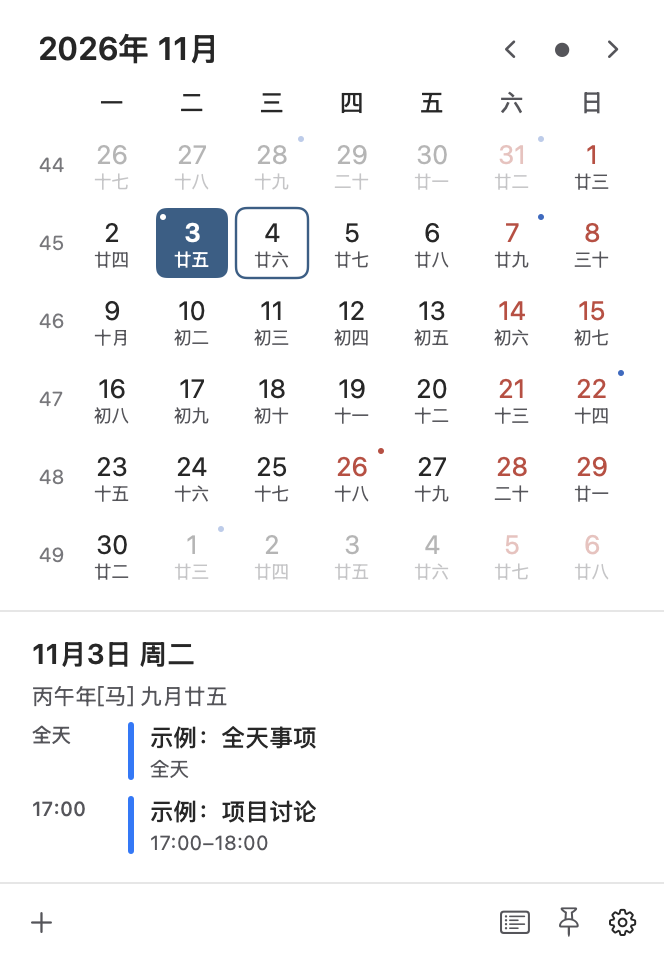

# 万年历 · Mac 菜单栏上的农历日历（个人定制版）

此仓库 Fork 自 [zfdang/chinese-lunar-calendar-for-mac](https://github.com/zfdang/chinese-lunar-calendar-for-mac)，保留原作者版权和 MIT 许可证。此分支在上游 4.5.1 的基础上加入菜单栏日期格式、可调尺寸的 A 版单栏月历，以及 macOS 系统日历日程展示。

点一下菜单栏，今天的农历、节气、放假调休和即将到来的重要日子一目了然。为家人记下农历生日，也为自己留住值得纪念的日期。

**免费开源 · macOS 13+ · 支持 Apple 芯片和 Intel 芯片 · 浅色与深色外观**

[本 Fork 的发行版](https://github.com/Yhmmmm/chinese-lunar-calendar-for-mac/releases) · [上游网站](https://calendar.zfdang.com) · [更新历史](CHANGELOG.md)

[查看深色外观](WanNianLiSwift/Docs/calendar-layout-a-dark.png)。截图使用隔离的示例日程，不包含真实日历内容。

## 随时查看，日子心中有数

- **农历就在菜单栏**：可选日期图标、`10月28日 周三` 文字或自定义组合，点击展开月历，查看农历、干支、生肖与二十四节气，支持 1901–2099 年。
- **均衡单栏月历**：周一开周，公历下方固定显示农历；可选小、标准、大三档，也可固定为独立窗口。
- **系统日程**：主动授权后在日期上显示日程标记，下方列出所选日期的全天事件和起止时间；点击可在系统日历中定位事件。
- **放假还是上班**：按国务院公布的安排显示放假和调休上班，每周自动检查假日信息更新。
- **记住生日和纪念日**：支持每年农历、每年公历、某月第几个星期几及单次日期，适合家人生日、周年纪念和个人安排。
- **提前看看重要日子**：点击底部“即将到来”，可查看未来 90 天内最多 6 项重要日期，点击即可跳转。
- **选择你关心的节日**：传统节日、公历节日、常见西方节日、国内和国际纪念日可分别开关，也可选择英国各地区、美国、法国、德国的公共假日日历。同名节日合并显示并标注国家，国外节日不改变中国调休安排。
- **按自己的习惯使用**：支持跟随系统、日间和夜间外观，可设置开机自动启动；自定义日期可以导入、导出备份。

## 下载与安装

本定制版的安装包发布在[此 Fork 的 GitHub Releases](https://github.com/Yhmmmm/chinese-lunar-calendar-for-mac/releases)。发布前也可按[开发说明](WanNianLiSwift/DEVELOPMENT.md)在本机自行构建：

| 你的 Mac | 选择版本 |
| --- | --- |
| Apple M 系列芯片 | `WanNianLiSwift-<版本>-AppleSilicon.zip` |
| Intel 芯片 | `WanNianLiSwift-<版本>-Intel.zip` |

不确定芯片类型时，打开苹果菜单 →“关于本机”查看。本定制版需要 **macOS 13 或更新版本**；较早的系统可从[上游网站](https://calendar.zfdang.com)下载旧版。

1. 下载并解压，将 **WanNianLiSwift.app** 拖入“应用程序”文件夹。
2. 打开应用，点击菜单栏的日期图标即可使用。
3. 如需开机启动，在日历左下角的设置菜单中开启“自动启动”。

应用尚未经过 Apple 公证。首次打开如被 macOS 阻止，可在“系统设置 → 隐私与安全性”中查看提示，并允许打开你确认从上述地址下载的应用。

## 从这里开始

**查看一天的详情**：点击日期，下方显示农历、节日和当日系统日程。首次使用系统日程时，点击“连接系统日历”并按需授权；日程数据只在本机读取。

**添加生日或纪念日**：点击月历左下角的“＋”，或从设置菜单打开“自定义日期”，再添加条目。家人的农历生日选择“每年农历”，公历生日选择“每年公历”，以后会自动出现在对应日期和“即将到来”中。

**快速浏览月份**：使用顶部月份标题和翻页按钮，也可以按 ← / → 切换年份、↑ / ↓ 切换月份，按回车回到今天。按住 Command 拖动菜单栏图标，可调整它的位置。

## 此 Fork 的新增

- A 版均衡单栏布局、周一开周、固定农历和底部操作栏。
- 菜单栏日期样式编辑、月历三档尺寸、可固定窗口与浏览日期记忆。
- macOS 系统日历只读日程、时间线和点击定位。

## 上游 4.5.1 更新

- 修复“接下来”一行中事件名称被挤掉的问题。
- 节日、生日和节气回到日期详情右侧，多个事件利用两行显示，面板高度保持稳定。
- 每个事件独立着色，同一天的生日不再把其他纪念日一起染红。

更多版本变化见[更新历史](CHANGELOG.md)。

## 帮助与反馈

此定制版的问题可在[本 Fork 提交 Issue](https://github.com/Yhmmmm/chinese-lunar-calendar-for-mac/issues)。原项目的问题请到[上游仓库](https://github.com/zfdang/chinese-lunar-calendar-for-mac/issues)反馈。

开发、构建和测试见[开发说明](WanNianLiSwift/DEVELOPMENT.md)；发布步骤见[发布流程](RELEASE.md)；节日数据的来源和范围见[节日说明](WanNianLiSwift/Data/FESTIVALS.md)。仓库也保留了旧版实现，供历史版本维护与参考。

## 许可证

本项目以 [MIT 许可证](LICENSE) 开源。旧版中的第三方组件沿用各自许可证；新版节日数据的来源与许可见[节日说明](WanNianLiSwift/Data/FESTIVALS.md)。
